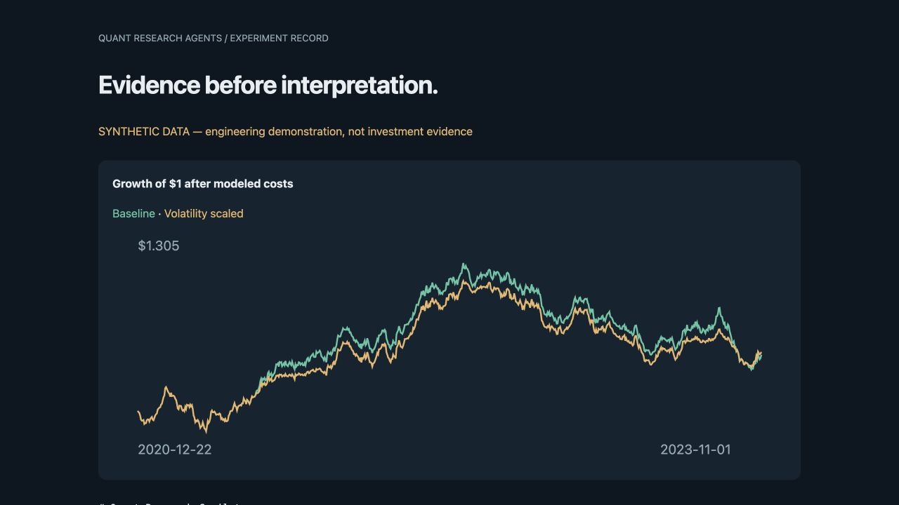
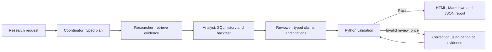

# Quant Research Agents

Google ADK agents that retrieve methodology, inspect an experiment database,
run a controlled momentum comparison, and save a report whose structured
numerical claims are checked against the computed return streams.

**Status: working first milestone.** The no-key demo runs the actual ADK graph
with explicitly scripted model responses and real Python/SQL tools. Gemini
integration is implemented but has not yet been verified with a live API key.
The included data is synthetic. There are no claims of investment performance
or measured improvements from multiple agents.



## Run the demonstration

Python 3.11 or newer:

```sh
python3 -m venv .venv
source .venv/bin/activate
python -m pip install -e ".[dev]"
quant-agents demo
```

The command prints paths to an HTML report, Markdown report, and structured JSON.
Each run also writes a tool trace and execution metadata under `workspace/runs/`.
Experiments are stored in `workspace/experiments.sqlite3` by default. Repeating
the same configuration does not duplicate its experiment record.

```sh
quant-agents demo --architecture single
quant-agents history
pytest -q
ruff check .
```

`demo` follows one fixed script. It does not answer arbitrary questions and its
results are not an evaluation of LLM quality. [Sample report](docs/example-report.md).

## Run with Gemini

```sh
cp .env.example .env
# Set GOOGLE_API_KEY in .env locally.
quant-agents run "Compare baseline and volatility-scaled momentum on the bundled synthetic fixture with 5 basis points of costs. Cite methodology and save a report."
```

`QUANT_MODEL` defaults to `gemini-flash-latest`. Set it to an available concrete
model ID before collecting reproducible benchmarks. The CLI limits each request
to 16 model calls and 180 seconds; these are execution bounds, not a dollar budget.
Live requests use your provider account and may incur charges.

For the ADK development interface, run from the repository root:

```sh
adk web --max_llm_calls 16 agents
```

Select `research_copilot`. Use a new session for a new experiment. The development
interface runs the same graph with the command above's call limit. The CLI also
enforces the time limit and exports complete traces. Conversational sessions are in memory
in the CLI; the SQL experiment records and exported artifacts persist.

## Workflow



The ADK 2 graph uses `Workflow` with explicit edges. Four `LlmAgent` nodes
coordinate through session state. A deterministic finalizer recomputes metrics
from saved returns, checks both variants’ numerical claims, and accepts only
retrieved citation IDs before writing a report. Invalid numerical claims or citation
IDs get one correction attempt with validation feedback and canonical evidence. The correction
agent has no tools and cannot change the experiment. A second invalid review fails
the run without publishing a report. Stored-data integrity errors and malformed
output rejected by the SDK are not eligible for this correction step.

The single-agent baseline uses the same retrieval, SQL, experiment, and validation
tools. It combines planning, execution, and review in one agent so the development
evaluation can compare orchestration choices. Both architectures use the same
optional correction step, which is recorded separately in run metadata.

## What is implemented

| Capability | First milestone |
|---|---|
| Google ADK and Gemini | Four-agent graph, single-agent baseline, typed plans and review output |
| Function calling | Retrieval, bounded SQL queries, deterministic backtest, optional FRED request |
| Retrieval | BM25 over five attributed methodology notes; unknown queries return no evidence |
| SQL | SQLite default and an optional PostgreSQL adapter; parameterized queries and idempotent writes |
| External API | FRED context with bounded retries, timeouts, and sanitized errors |
| Execution | Two momentum variants using attributed code from quant-research-system |
| Verification | Numerical checks, citation-ID checks, trace export, tests and a CI template |
| Evaluation | Eight development cases, isolated databases, shuffled order, repeated trials and failure artifacts; no live scores reported yet |

Retrieval is deliberately small in this release. The trained hybrid retriever from
[quant-retrieval](https://github.com/melihgiray/quant-retrieval) is not connected yet.
The momentum and regime-sizing functions are reused from
[quant-research-system](https://github.com/melihgiray/quant-research-system), with
a pinned revision and preserved MIT license in `src/quant_research_agents/_vendor/`.
The runner uses simplified flat-basis-point costs, not the full upstream engine.

## PostgreSQL and external context

SQLite needs no setup. For PostgreSQL:

```sh
python -m pip install -e ".[postgres]"
docker compose up -d db
# Add DATABASE_URL from .env.example to .env.
quant-agents demo
```

The Compose database is local development only and binds to localhost. Set
`TEST_POSTGRES_URL` to a disposable database to run the PostgreSQL integration test.
The [CI template](docs/ci.example.yml) provisions a PostgreSQL service for that test.
It is not enabled yet: the publishing connection lacks GitHub's workflow permission.
To enable it, copy the template to `.github/workflows/ci.yml` and commit it using a
connection with that permission. The local test suite skips PostgreSQL if no test
database is configured.

Set `FRED_API_KEY` in `.env` to enable `fetch_macro_context`. The allowed series
are `VIXCLS`, `DGS10`, and `FEDFUNDS`. Current observations provide optional report
context only: they never enter historical strategy calculations. Missing credentials
and unavailable APIs produce explicit tool statuses, not fabricated observations.

## Evaluate the agents

```sh
quant-agents evaluate --live --cases evals/cases.json
# Optional repeated trials (48 live runs for the eight supplied cases):
quant-agents evaluate --live --trials 3 --seed 42
```

This makes live model calls for both architectures. The eight cases are a
development set, not a held-out benchmark. They check requested parameters,
tool use, supported execution, and refusal of unsupported requests. Manually
review citation entailment, interpretation, and traces. Every attempt gets a fresh
SQLite database, including when `DATABASE_URL` is set. Execution order is shuffled
using the recorded seed; results are checkpointed after every attempt. Failed runs
retain their metadata and traces. Token usage is
recorded when the provider supplies it; unavailable usage and uncomputed dollar
cost remain `null`, never zero. See [evaluation protocol](docs/EVALUATION.md).

## Limitations and next steps

- The synthetic prices and simplified execution model demonstrate engineering,
  not economic evidence. See [methodology](docs/METHODOLOGY.md).
- Citation validation confirms source IDs were retrieved. It does not prove that
  a source supports every sentence. Free-form interpretation remains model output.
- Live Gemini behavior and live FRED access require credentials and have not been
  verified in this initial implementation. FRED failure paths use mocked HTTP tests.
- Full hybrid retrieval, real market data, the original walk-forward engine,
  persistent conversational sessions, CrewAI, and a second LLM provider are planned.
- Current requests are one experiment per session; no live trading or arbitrary
  SQL/code execution is exposed to the model.

[Architecture and decisions](docs/ARCHITECTURE.md) · [Roadmap](docs/ROADMAP.md)

## References

- [Google ADK](https://adk.dev/)
- [ADK structured outputs](https://adk.dev/agents/llm-agents/)
- [ADK evaluation](https://adk.dev/evaluate/)
- [FRED observations API](https://fred.stlouisfed.org/docs/api/fred/series_observations.html)

MIT licensed. Upstream notices are preserved alongside reused code.
